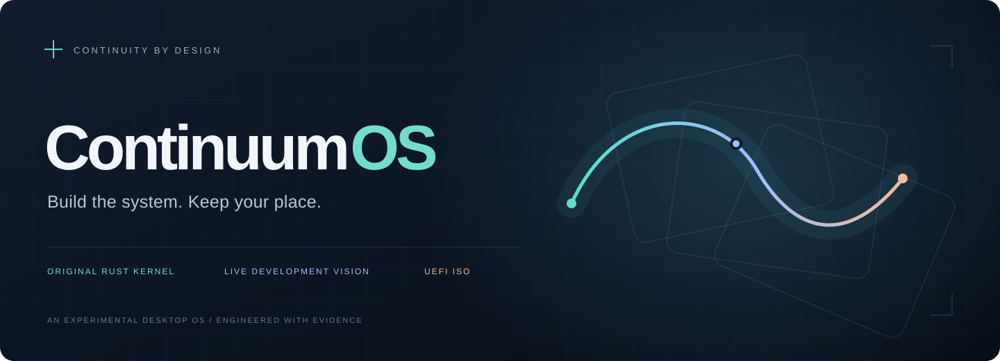
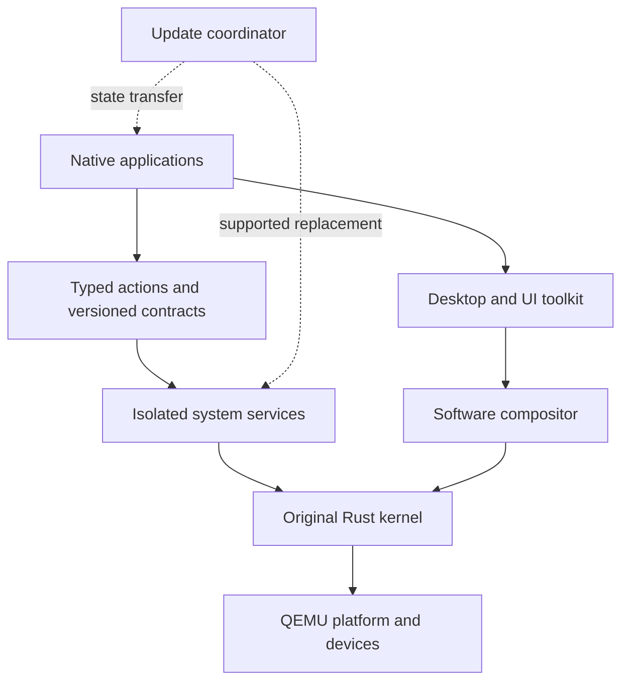

<p align="center">
  
</p>

<p align="center">
  <strong>Build the system. Keep your place.</strong><br />
  An original Rust operating system exploring a desktop that can evolve while you work.
</p>

<p align="center">
  <code>UEFI ISO: cold boot verified</code> · <code>Original Rust kernel</code> · <code>Early kernel</code>
</p>

<p align="center">
  <a href="#the-idea"><strong>The idea</strong></a> ·
  <a href="#what-runs-today"><strong>What runs</strong></a> ·
  <a href="#build-and-boot"><strong>Build &amp; boot</strong></a> ·
  <a href="docs/README.md"><strong>Engineering library</strong></a> ·
  <a href="docs/05-delivery/milestones.md"><strong>Roadmap</strong></a>
</p>

---

> **U.S.-only handling · all rights reserved.** Uploads, pushes, external sharing,
> and remote processing are on hold pending verified U.S.-only infrastructure.
> Legal export classification is pending. Read [EXPORT_CONTROL.md](EXPORT_CONTROL.md).

## The idea

Change a theme. Change an application. Eventually, replace a supported service.
Keep the document open, preserve the unsaved text, and keep the machine running.

ContinuumOS is being designed around that development loop: **edit source → build
→ update the running guest → continue working**. State continuity, explicit
compatibility contracts, and recoverable transitions belong in the architecture
from the beginning.

The destination is a coherent, responsive desktop with an original Rust kernel,
hardware-isolated services, carefully measured software rendering, and an
independently buildable bootable ISO. The kernel and OS architecture are authored
here; firmware, the bootloader, and selected libraries are reused with pinned
inputs and recorded provenance.

**Today, the original kernel boots, validates owned boot metadata, installs owned
exception tables, owns page tables and physical frames, enforces WP/NX and stack
guards, and reports bounded fatal diagnostics correlated to its build and
host-provided session.** The desktop,
isolation, persistent files, and live-update behavior are future evidence gates.

## What runs today

The first complete path through the machine is real:

```text
Standalone UEFI ISO
        │
        ▼
   OVMF firmware ──► Limine ──► Original Rust kernel
                                      │
                                      ▼
                     Entry → checked metadata → exceptions → owned memory → timer → ready
                              Build ID + host session + sequence
```

P1-03's smoke and metadata identity checks cold-boot **identical kernel bytes with
a fresh configured ISO for each launch**, using separate QEMU processes and firmware variable stores.
Each successful test requires matching version-2 entry, validated metadata,
resource summaries, completion records and emulator exit 33. Expected metadata
rejections require the exact field/reason and exit 35. Missing markers, incorrect
identities, panics and timeouts cannot count as successful boots. Host session IDs
provide correlation; they are not security credentials or reset detectors.
P1-04 extends the current record contract to version 3 and adds real invalid-opcode,
page-fault, panic and held-logger tests, each requiring its exact fatal context and exit 37.
P1-05 extends the current contract to version 4 and requires owned memory readiness
before completion or any expected fatal case. Guest inspection and actual faults
check frame ownership/zeroing, WP/NX, guards and double-fault IST entry. P1-06 adds version-5 ACPI/timer records, returning interrupts, calibrated delivered-tick uptime and idle continuation.

| Proven in this repository | Evidence |
| :--- | :--- |
| Independent freestanding kernel and userland link probes; matching bytes across two clean builds | [Phase 0 results](evidence/phase-0/README.md) |
| Native Windows emulator, ISO tooling, firmware, and loader inputs pinned by version and hash | [P1-01 review](evidence/phase-1/P1-01/2026-10-18/README.md) |
| Original Rust kernel entry through a real UEFI optical ISO | [P1-02 acceptance](evidence/phase-1/P1-02/2026-10-18/README.md) |
| Deliberately broken boots rejected; emulator processes cleaned up | [Failure records and acceptance criteria](evidence/phase-1/P1-02/2026-10-18/README.md#reviewed-acceptance-criteria) |
| Checked owned boot descriptors, retained reservations, correlated records and eight metadata rejection cases | [P1-03 acceptance](evidence/phase-1/P1-03/2026-10-18/README.md) |
| Separate host build/package/launch/observe modules; 18 host tests and 17 QEMU launches pass after extraction | [Module-refactor regression review](evidence/phase-1/m1-module-refactor/2026-10-18/README.md) |
| Owned exception tables/static stacks and bounded fatal diagnostics; 19 host tests and 21 VM launches pass | [P1-04 acceptance](evidence/phase-1/P1-04/2026-10-19/README.md) |
| Owned frames/page tables, enforced WP/NX, guarded stacks and real double-fault entry; 23 host tests and 27 selected launches pass | [P1-05 acceptance](evidence/phase-1/P1-05/2026-10-19/README.md) |
| Validated ACPI/xAPIC/HPET, real timer delivery/masking, monotonic uptime, registers and idle wakeups; 27 host tests and 36 selected launches pass | [P1-06 acceptance](evidence/phase-1/P1-06/2026-10-20/README.md) |

The [final source formatting check](evidence/phase-1/P1-04/2026-10-19-formatting/README.md)
adds one passing fault launch after an EOF-only assembly cleanup.

The current profile is **x86-64 · Q35 · TCG · one vCPU · 2 GiB RAM · offline**.
It attaches the exact ISO and firmware pair, with no host shares or writable user
data disk. **M1's declared experimental baseline passes local acceptance**:
[P1-07's complete review](evidence/phase-1/P1-07/2026-10-20-acceptance/README.md)
covers 33 rows and 42 launches, including five consecutive normal boots and the
second clean ISO boot/comparison. There is no general heap or user-mode isolation yet.

The next milestone is decomposed into [one epic and thirteen local Phase 2 stories](docs/05-delivery/phase-2/README.md):
compare Slint/custom UI, select provisionally, and prove hosted resource/layout
reload with preserved work. P2-01's [local prerequisite/profile/lifecycle acceptance](evidence/phase-2/P2-01/2026-10-20/README.md)
passes. P2-02's [shared-boundary/corpus acceptance](evidence/phase-2/P2-02/2026-10-21/README.md)
also passes. P2-03's [document state/action acceptance](evidence/phase-2/P2-03/2026-10-21/README.md)
passes shared execution, context and logical checkpoint checks.
P2-04's [bounded text acceptance](evidence/phase-2/P2-04/2026-10-21/README.md) adds
pinned fonts, shaping/bidi/fallback and composition fixtures with text rasters.
P2-05–P2-13 remain Not started; the custom and Slint candidates are next.
No candidate UI is rendered yet and no Jira issues were created.

## A desktop designed for continuity

Historical logs and copied source trees were [removed from Git tracking](evidence/README.md)
at the owner's request. Reviews and manifests remain; raw artifacts require the
preserved local copies or the recorded earlier Git revision.

These are engineering goals, each with an explicit acceptance gate.

| Principle | What it means |
| :--- | :--- |
| **Keep the work** | Supported updates preserve unsaved text, selection, window geometry, and usable focus. |
| **Make change explicit** | Versioned protocols and state migration define what can be replaced and when. |
| **Stay responsive** | Bounded work, sleeping idle components, and measured costs guide the UI. |
| **Account for every byte** | The provisional desktop cold-idle target is **256 MiB**, including services, framebuffers, and caches. |
| **Share the same actions** | UI controls, shortcuts, and automation use typed operations with the same authorization. |
| **Keep the core independent** | Optional inference follows the first state-preserving guest reload; it never gates the ordinary desktop. |

The defining future demo is an editor with unsaved work surviving a visible
resource update and a behavior replacement, with **unchanged kernel boot identity
and uptime**. That demonstration has not happened yet. General kernel hot reload
is outside the initial guarantee; kernel and boot changes initially require a reboot.

## Architecture, with gates



This is the **proposed architecture**, beyond the minimal boot path implemented
today. Slint and a minimal custom UI must compete through a measured prototype
before toolkit selection. GPU acceleration, third-party crate ports, and guest
runtime support each need their own validation.

[Architecture overview](docs/00-overview/architecture-summary.md) ·
[Live-update guarantees](docs/03-live-update/model-and-guarantees.md) ·
[Decisions and alternatives](docs/04-decisions/README.md)

## Build and boot

During the U.S.-only hold, do not run acquisition commands or use unverified remote
services. Cargo defaults to offline mode; these commands are for a verified local
environment with the required inputs already supplied. Scoped owner push
exceptions are recorded in [the handling policy](EXPORT_CONTROL.md); they do not
approve a remote environment or lift the general hold.

The tested host is native Windows with PowerShell 7, MSVC, and the Windows SDK.
Rust and the supplied emulator/packaging tools live under ignored `work/`.
Follow the [setup runbook](docs/05-delivery/phase-0.md) and
[pinned prerequisite guide](docs/05-delivery/phase-1/prerequisites-runbook.md)
before running these commands from the repository root:

```powershell
. ./tools/Enter-Dev.ps1

# Verify the exact emulator, firmware, loader, and ISO-tool inputs.
cargo xtask doctor --profile m1

# Build the original kernel, package its ISO, and observe a bounded boot.
cargo xtask build --profile dev
cargo xtask iso --profile m1
cargo xtask run --profile vm-baseline

# Two fresh configured ISOs with the same kernel and distinct sessions.
cargo xtask test --suite m1 --case iso-smoke

# Owned metadata, module/serial-only fixtures and exact rejection cases.
cargo xtask test --suite m1 --case boot-metadata
cargo xtask test --suite m1 --case boot-reject

# Actual fatal diagnostics; expected fault exits are separate from normal boot.
cargo xtask test --suite m1 --case exception-invalid-opcode
cargo xtask test --suite m1 --case exception-page-fault
cargo xtask test --suite m1 --case panic
cargo xtask test --suite m1 --case exception-emergency
```

Each command prints its artifact directory. `run` packages a fresh ISO, observes
completed metadata diagnostics for one host second, then stops and reaps QEMU;
that stop is host cleanup. The named tests check the emulator-only exit device.
These commands do not start an interactive desktop.

The pinned xorriso runtime needs execution outside the Codex sandbox's Windows
named-object restriction. Tool acquisition is explicit; builds do not silently
install WSL, enable virtualization features, or modify global packages.

[Complete boot runbook](docs/05-delivery/phase-1/minimal-iso-runbook.md) ·
[Metadata and identity contract](docs/05-delivery/phase-1/boot-metadata-runbook.md) ·
[Fatal exception contract](docs/05-delivery/phase-1/exception-diagnostics-runbook.md) ·
[Full current regression harness](tools/Test-P1-06.ps1)

Host orchestration starts at [m1.rs](tools/xtask/src/m1.rs). The
[module layout](docs/05-delivery/phase-1/minimal-iso-runbook.md#host-harness-source-layout)
separates compilation/audits, ISO packaging, QEMU preparation and process observation;
named cases and strict serial-record checks remain separate.

## From first instruction to a living desktop

| Gate | Outcome | Current state |
| :--- | :--- | :--- |
| **Phase 0** | Native tooling, independent links, dependency feasibility | Compile/tooling evidence retained |
| **M1** | Standalone ISO boot, validated handoff, exceptions, memory, timers | P1-01–P1-07 pass local experimental-baseline acceptance |
| **M2** | Hosted UI comparison, accessibility foundations, resource continuity | P2-01 prerequisites through P2-04 bounded text accepted; candidate rendering remains planned |
| **M3** | User-mode isolation and bounded IPC | Planned |
| **M4** | Authenticated development channel and guest resource reload | Planned |
| **M5** | App replacement with preserved state | Planned |
| **M6–M8** | Service evolution, persistence, recovery, and release validation | Planned |

[Milestone acceptance criteria](docs/05-delivery/milestones.md) ·
[Ordered implementation stories](docs/05-delivery/phase-1/README.md) ·
[Requirements and performance targets](docs/00-overview/requirements.md)

## Explore the engineering

| Start here | Go deeper |
| :--- | :--- |
| [Vision and scope](docs/00-overview/vision-and-scope.md) | [Kernel and execution](docs/02-architecture/kernel-and-execution.md) |
| [Approved revision-2 direction](docs/00-overview/reconciled-plan.md) | [State transfer and compatibility](docs/03-live-update/state-and-compatibility.md) |
| [Source-backed research](docs/01-research/sources.md) | [UI toolkit comparison](docs/01-research/ui-toolkit-comparison.md) |
| [Validation and traceability](docs/05-delivery/validation.md) | [Wire contracts and schemas](docs/06-contracts/README.md) |

For implementation work, read [AGENTS.md](AGENTS.md) and the
[agent handoff](docs/05-delivery/agent-handoff.md). Work through one evidence gate
at a time, preserve failed runs, and update the relevant specifications when
experiments change a decision.

## Project policies

Original project material is **all rights reserved**. Third-party components keep
their own licenses. External patches are paused pending an approved contributor
agreement; repository access does not grant commercial or redistribution rights.

[Rights and permissions](LEGAL.md) · [Third-party notices](THIRD_PARTY_NOTICES.md) ·
[Contribution policy](CONTRIBUTING.md) · [Governance](GOVERNANCE.md) ·
[Code of conduct](CODE_OF_CONDUCT.md) · [Security](SECURITY.md) ·
[Support](SUPPORT.md) · [Privacy](PRIVACY.md) · [Release gates](RELEASE.md) ·
[U.S.-only handling](EXPORT_CONTROL.md)

---

<p align="center">
  <strong>ContinuumOS</strong> is a working name. Early research and implementation.<br />
  Original project material: all rights reserved. Upstream components retain their own licenses.<br />
  <sub>A coherent desktop. Explicit boundaries. Your work, carried forward.</sub>
</p>
