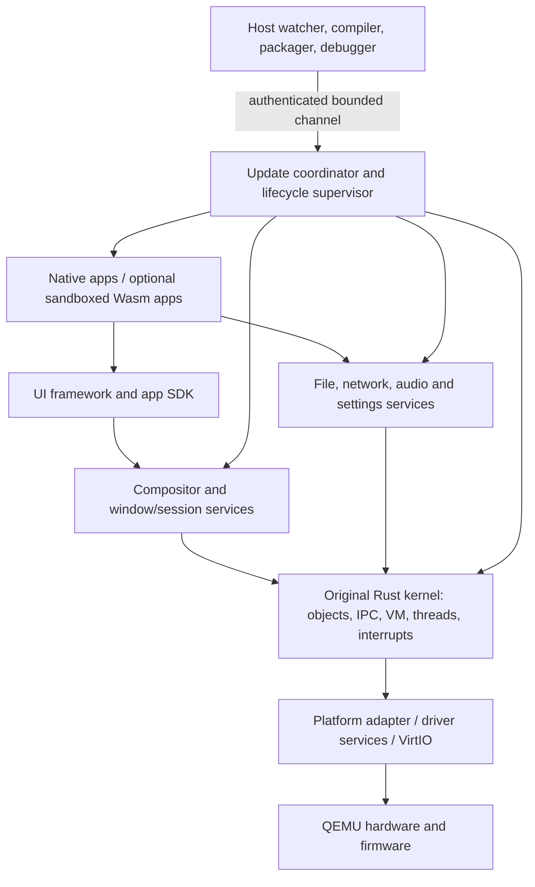

# Architecture summary

Status: proposed default. Read [requirements](requirements.md) before changing scope.

## Recommendation

Use an original Rust kernel with page-table isolation, capability-style handles,
bounded message IPC, and shared memory for bulk surfaces. Keep the first kernel
small: address spaces, threads, scheduling, interrupts, timers, object handles,
IPC, and tightly mediated hardware access. Put storage, networking, app hosting,
desktop policy, and update orchestration into services. A few bootstrap drivers
may temporarily be trusted kernel code, tracked for extraction.

Use a single CPU initially with preemption and explicit quotas. Add SMP only after
isolation, interrupt handling, state transitions, and update tests are reliable.
“Microkernel” is a direction and boundary discipline, not a claim of seL4-level
verification or automatically superior speed.

The arrows illustrate dependencies, not trust equivalence. The supervisor,
resource brokers, loaders, renderer, and kernel have different authorities.
The stable development core remains nonreloadable initially; reloading the
supervisor that performs reloads creates a separate recovery problem.

Revision 2 adds a shared typed-action/context contract, with optional isolated inference
after M5. The ordinary desktop and first no-reboot editor demonstration must work
without a model. Compare Slint/custom UI prototypes before committing to an app toolkit.

## Language placement

| Layer | Initial language/tool | Boundary |
| --- | --- | --- |
| Kernel, first-party drivers | Rust `core` and explicitly enabled `alloc` | Tiny documented assembly/intrinsic boundary |
| Native services | Rust, custom user ABI/SDK | Separate process images; no presumed `std` target |
| UI toolkit and renderer | Slint/custom comparison; portable Rust integration | Shared app/surface/input/action contracts; host preview and guest backend |
| Themes and layout assets | Validated versioned data | No arbitrary evaluation from a theme file |
| Reloadable app logic | Rust native processes; Wasm experiment | Wasm is not required for first UI reload |
| Development tools | Host Rust `xtask`/CLI; small scripts as needed | Not shipped inside the guest |

The Rust bare-metal target supplies no OS services or default allocator.
That is a verified platform constraint, not an implementation detail to ignore.
[S01](../01-research/sources.md#s01)

## Live evolution model

Assets can update at a scene commit. App behavior can update by starting a new
isolated instance, exporting versioned logical state, importing it into the new
instance, and switching its service route at a quiescent point. Native code
does not get unloaded underneath arbitrary running stacks.

Resource handles use brokered identity; serialization does not preserve arbitrary
pointers, stacks, GPU objects, or network connections. Long-lived files, documents,
windows, and service routes need explicit ownership. Resource brokers enable
replacement, but enlarge the stable core and must be constrained and tested.

Updates progress through validate, stage, quiesce, migrate, prepare, activate,
health-check, finalize, and retire. The single-writer rule, durable generation
records, side-effect policy, and crash recovery are mandatory before calling
service replacement safe. See [the transaction spec](../03-live-update/protocol-and-transactions.md).

## First graphics path

Start with framebuffer presentation and a deterministic software renderer.
Retain scenes, invalidate changed regions, clip obscured work, bound caches,
and sleep when idle. Separate layout from painting and composition. Reuse the
selected UI implementation in host tests and the guest. Toolkit-private scene trees
need not be exported: the common surface API also accepts rasterized app buffers.

VirtIO GPU 2D is a display transport, not automatic hardware shader support.
Investigate accelerated command submission only at a dedicated gate. QEMU's
accelerated backends still require a compatible guest stack.
[S37](../01-research/sources.md#s37)

## Persistent system model

Immutable content-addressed packages identify system generations. User data,
settings, checkpoints, and activation metadata live on an optional writable disk.
The first live ISO may be ephemeral and say so explicitly. A later ISO can be
generated from an exact known package graph without rebuilding on every live edit.

An image rollback is not a user-data rollback. Irreversible schema changes or
external side effects invalidate effortless reversal. Support compatibility windows,
documented migration paths, and rescue boot.
Boot-attempt/known-good selection is separate from live state transfer; A/B slots are a later packaging choice.

## Critical experimental gates

1. Host-to-guest boot and toolchain feasibility on this Windows environment.
2. Same UI engine on a host surface and a guest framebuffer.
3. Real user-mode isolation and bounded IPC, not only Rust modules.
4. State-preserving service replacement under input load and injected failures.
5. Crash-consistent activation before persistent live updates.
6. Measured graphics performance before promising high-refresh effects.

If a gate fails, revise its ADR with evidence. Do not replace the original OS with
an existing kernel or silently turn hot updating into VM rebooting.
